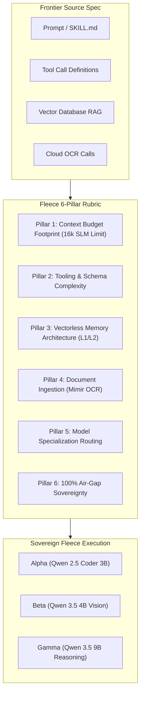

# Fleece Sovereign Agent & Skill Audit Playbook
**Auditing Frontier Platform Agents & Skills for Sovereign Fleece Crate Motor Execution**

---

## 1. Executive Mandate: The Frontier-to-Sovereign Gap

Frontier platforms (OpenAI, Claude/Anthropic, Google Antigravity, LangChain/LangGraph, CrewAI) operate on the assumption of:
1. **Unbounded Cloud Context:** 128k, 200k, or 1M+ token windows backed by cloud clusters.
2. **Proprietary Vector Stores:** Hardcoded dependencies on Pinecone, Chroma, or Weaviate requiring active embedding APIs.
3. **Cloud OCR / Vision Telemetry:** Network calls to `gpt-4o` Vision, AWS Textract, or Azure Computer Vision.
4. **Loosely Typed / Sprawling Tool Sets:** Dozens of multi-nested parameters that overwhelm 3B–9B parameter models.

**Project: Fleece** replaces this fragility with a **Sovereign AI Crate Motor** running locally on CPU/Metal with zero network leakage.

This playbook establishes the deterministic **6-Pillar Audit Rubric** to evaluate, audit, and refactor any Frontier agent or skill for 100% compatibility across **Fleece Alpha**, **Beta**, and **Gamma**.

---

## 2. The 6-Pillar Audit Rubric



### Pillar 1: Context Budget Footprint (16k SLM Limit)
- **Constraint:** Fleece enforces a strict **16,384 token ceiling**, a **1,200 token system anchor limit**, and a **2,048–4,096 completion buffer**.
- **Audit Rule:**
  - ❌ **FAIL:** Preamble or background documents exceeding `16,384` tokens.
  - ⚠️ **WARN:** Static preamble text exceeding `3,500` tokens.
  - ✅ **PASS:** Lean, high-signal system prompt (`< 1,200` tokens) with domain background stored in `storage/markdown/knowledge/`.
- **Refactoring Strategy:** Strip monolithic documentation out of the system prompt and drop it into `storage/markdown/knowledge/<topic>.md`. Fleece's **Mimir PageIndex (L2)** navigates the document tree without consuming context tokens until a specific section is retrieved.

---

### Pillar 2: Tooling & Function Calling Complexity
- **Constraint:** 3B–9B SLMs excel with flat, strongly typed parameters (`str`, `int`, `bool`, `enum`). They degrade when faced with deeply nested dictionaries, polymorphic schemas, or $> 8$ active tools.
- **Audit Rule:**
  - ❌ **FAIL:** Deeply nested JSON schemas ($> 3$ levels), missing type annotations, or $> 12$ active tools.
  - ⚠️ **WARN:** $9$ to $12$ active tools in a single turn.
  - ✅ **PASS:** $\le 8$ flat, strictly typed functions with descriptive docstrings.
- **Refactoring Strategy:** Group related sub-tools into composite actions or page them on demand via Mimir PageIndex rather than presenting all schemas simultaneously.

---

### Pillar 3: Vectorless Memory Architecture (L1 / L2)
- **Constraint:** Fleece rejects destructive chunking, lossy embeddings, and cloud vector databases (Pinecone, Chroma, Weaviate, FAISS).
- **Audit Rule:**
  - ❌ **FAIL:** Hardcoded imports of `pinecone`, `chromadb`, `weaviate`, or embedding API calls (`text-embedding-3`).
  - ✅ **PASS:** Native two-tier markdown memory:
    - **L1 Living Dossier (`DOSSIER.md`):** Fast-path cache of verified facts, user preferences, and case records.
    - **L2 PageIndex (`PAGE_INDEX.json`):** Hierarchical document map preserving 100% of tables, code blocks, and section anchors.

---

### Pillar 4: Document Ingestion & Vision Readiness (Mimir OCR)
- **Constraint:** No cloud vision or OCR APIs (OpenAI Vision, AWS Textract, Azure Document AI).
- **Audit Rule:**
  - ❌ **FAIL:** Cloud OCR API calls requiring internet connectivity.
  - ✅ **PASS:** Sovereign **Mimir OCR** (`sieve_ocr.py`):
    - **Pass 1:** OS-Native OCR (<150 ms/page, zero RAM).
    - **Coordinate Delta-Masking:** Crops only sub-crops where `confidence < 0.85`.
    - **Pass 2:** Targeted CPU `RapidOCR` ONNX runtime on low-confidence crops.
    - **Pass 3:** In-process `MiniCPM-V 2.6` local VLM fallback for cursive/marginalia.
    - **Normalized Coordinates:** Every text block is grounded with `[x0, y0, x1, y1]`.

---

### Pillar 5: Model Specialization Routing
Match the audited workload to the right Fleece Crate Motor edition:

| Workload Characteristics | Target Fleece Edition | Core Specifications |
| :--- | :--- | :--- |
| **Deterministic Code, SQL, Text Editing, CLI Tools** | **Project: Fleece Alpha** | Qwen 2.5 Coder 3B Instruct, 16k context, sub-50ms latency |
| **Visual Document Inspection, Screenshots, Charts, UI** | **Project: Fleece Beta** | Qwen 3.5 4B Vision Instruct + `mmproj`, direct visual tensor ingestion |
| **Multi-Step Analytical Logic, Compliance Audit, Deep Reasoning** | **Project: Fleece Gamma** | Qwen 3.5 9B Defiant Fable, switchable `plusIQ` reasoning modes (`{REASON:einstein}`, `{REASON:spoon}`) |

---

### Pillar 6: Air-Gap Sovereignty & Zero Cloud Leakage
- **Constraint:** Zero network calls, zero tracking telemetry, zero remote API keys.
- **Audit Rule:**
  - ❌ **FAIL:** Hardcoded `api.openai.com`, `api.anthropic.com`, `sk-...` API keys, or remote telemetry pings.
  - ✅ **PASS:** Local in-process llama.cpp GGUF execution via `fleece.py` with zero internet dependency.

---

## 3. Platform-Specific Conversion Guides

### A. Converting Google Antigravity (AGY) Skills (`SKILL.md`)
Antigravity skills define instructions, scripts, and MCP tools in a directory containing `SKILL.md`.

**Audit Checklist for AGY Skills:**
1. Check token size of `SKILL.md` (keep `< 2,500` tokens).
2. Move large reference manuals from `references/` into `storage/markdown/knowledge/`.
3. Wrap bash or python scripts into sovereign CLI commands or Crate Motor `motor.execute()` calls.

### B. Converting OpenAI Custom GPTs & Assistants
OpenAI Assistants bundle instructions, tool schemas, and vector stores ("File Search").

**Refactoring Path:**
1. **Instructions $\rightarrow$ System Anchor:** Copy the assistant instructions into `SYSTEM_DIRECTIVE` in `fleece.py` (ensure $\le 1,200$ tokens).
2. **File Search (Vector Store) $\rightarrow$ Mimir PageIndex:** Drop uploaded PDF/docx files through `motor.ingest_document("file.pdf")`. Mimir OCR generates normalized `[x0, y0, x1, y1]` coordinates and updates `PAGE_INDEX.json`.
3. **Function Calling $\rightarrow$ Python Tools:** Convert OpenAI JSON tool definitions into flat Python functions with clear type hints.

### C. Converting Anthropic Claude Projects & Artifacts
Claude Projects rely on 200k context windows to absorb dozens of background files into prompt memory.

**Refactoring Path:**
1. Do not paste files into the system prompt.
2. Ingest all files into Fleece's `storage/markdown/knowledge/` directory.
3. The L2 PageIndex tree allows Fleece SLMs to cite exact section anchors and page coordinates while consuming only $\sim 150$ tokens of index metadata.

### D. Converting LangChain / LangGraph & CrewAI
Multi-agent graphs often chain multiple heavy LLM calls with chat memory buffers.

**Refactoring Path:**
1. Replace `ConversationBufferMemory` or `Chroma` stores with Fleece's `StateGraphMemoryEngine`.
2. The Fleece Two-Tier State Graph automatically checks `DOSSIER.md` (L1) $\rightarrow$ navigates `PAGE_INDEX.json` (L2) $\rightarrow$ updates `DOSSIER.md` on newly discovered facts.

---

## 4. Running the Automated Auditor

Each Fleece edition includes the automated command-line auditor [`audit_agent.py`](file:///Users/ATLAS/Desktop/CODING/Projects/Project-Fleece/Project-Fleece-Gamma/audit_agent.py).

### CLI Usage:
```bash
# Audit a single prompt, script, or configuration
./audit_agent.py path/to/agent.py

# Audit a complete skill directory or repository
./audit_agent.py path/to/skill_folder/

# Export formatted Markdown report
./audit_agent.py path/to/skill_folder/ --format markdown --output AUDIT_REPORT.md

# Export machine-readable JSON for CI/CD pipelines
./audit_agent.py path/to/skill_folder/ --format json

# Strict mode: fails with exit code 1 if score < 80% or cloud leaks exist
./audit_agent.py path/to/agent.py --strict
```

### In-Session REPL Usage (Inside `fleece.py`):
```text
[You] > !audit /path/to/my_skill
```

---

## 5. Scoring & Certification Levels

| Score Range | Status | Meaning |
| :--- | :--- | :--- |
| **85 – 100%** | 🟢 **SOVEREIGN READY** | Zero cloud dependencies, compliant context budget, vectorless memory ready. Drops directly into Fleece Crate Motors. |
| **60 – 84%** | 🟡 **OPTIMIZATION ADVISED** | Functional on local SLMs, but prompt preamble is too large or tool schemas should be flattened for optimal accuracy. |
| **0 – 59%** | 🔴 **CLOUD REFACTOR REQUIRED** | Contains hardcoded cloud APIs, vector databases, or remote vision dependencies. Must be refactored using Mimir OCR and vectorless memory. |
